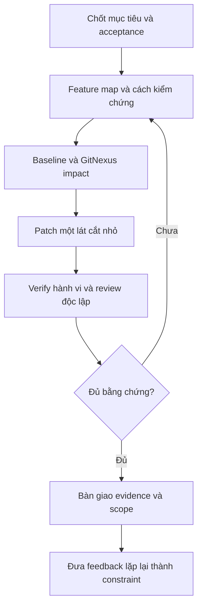

# Workflow agent cho session PickUp

Thiết kế ngày 2026-10-05, dựa trên sáu nguyên tắc người dùng cung cấp.
Mục tiêu: mỗi thay đổi có context, phạm vi và bằng chứng đủ để người khác kiểm tra lại.
Agent tự đi tiếp khi đạt điều kiện của từng bước; chỉ hỏi khi thiếu quyết định sản phẩm
hoặc hành động vượt phạm vi đã được giao.

## 1. Điểm xuất phát

- Checkout có backend Rust/Axum và client Expo/React Native trong `mobile/`.
  README ghi feature đã triển khai và giới hạn còn lại; ứng dụng owner riêng chưa
  triển khai. Không lấy sơ đồ kế hoạch làm bằng chứng native release đã chạy được.
- Các điểm kiểm chứng đã được mô tả trong [README](../README.md) và
  [backend CI](../.github/workflows/backend.yml): fmt, Clippy nghiêm ngặt,
  test gồm PostgreSQL/Redis, kiểm tra dependency và build container.
- `cargo test` mặc định bỏ qua các test DB/Redis được đánh dấu ignored.
  Suite mặc định xanh chưa chứng minh integration đã chạy.
- [Release checklist](backend-release-checklist.md) ghi bằng chứng lịch sử và
  các acceptance bên ngoài còn thiếu. Phải tạo evidence mới cho thay đổi của session.
- `CLAUDE.md` và `architecture.md` có phần kế hoạch khác README về client,
  auth và Redis. Đối chiếu implementation, test và tài liệu domain khi lập feature map;
  ghi rõ mâu thuẫn thay vì tự coi một tài liệu là sự thật tuyệt đối.
- Tại thời điểm thiết kế, GitNexus MCP không xuất hiện trong bộ công cụ của session.
  Các skill ở `.claude/skills/gitnexus/` cũng không tìm thấy tại đường dẫn hướng dẫn
  và các thư mục skill đã kiểm tra. Chưa chạy impact analysis hay baseline ứng dụng.

## 2. Vòng làm việc



| Bước | Agent thực hiện | Điều kiện đi tiếp / đầu ra |
| --- | --- | --- |
| 1. Task contract | Ghi hành vi mong muốn, acceptance, phạm vi và điều không xử lý trong task. | Có tiêu chí quan sát được để phân biệt đúng/sai; rõ một task ưu tiên. |
| 2. Context | Dùng GitNexus query tìm flow, context xem symbol; đọc tài liệu domain và test liên quan. Ghi feature map và pattern được chọn. | Biết entry point, dependencies, invariant và command kiểm chứng. |
| 3. Baseline + impact | Chạy scenario trước sửa và kiểm tra liên quan. Chạy upstream impact cho từng symbol định sửa, báo callers, flows, risk. | Hiện trạng đã ghi nhận; blast radius rõ; môi trường kiểm chứng hoạt động. |
| 4. Patch | Sửa một lát cắt đủ hoàn chỉnh, theo boundary đã xác minh. Với bug, thêm regression chứng minh lỗi trước và kết quả sau. | Diff tập trung, không kèm refactor ngoài mục tiêu. |
| 5. Verify + review | Chạy lại acceptance trên đúng patch cuối, các check bắt buộc và ứng dụng thật khi task thay đổi hành vi runtime. Reviewer kiểm tra diff và evidence. | Acceptance đạt, regression liên quan không xuất hiện, không còn check bắt buộc chưa chạy. |
| 6. Bàn giao | Tổng hợp thay đổi, evidence và giới hạn; đối chiếu scope thực tế bằng detect_changes trước commit. | Người khác tái chạy được; phạm vi khớp dự kiến; commit/PR chỉ khi nằm trong yêu cầu. |

Không có một lần hỏi approval ở mỗi bước. Cảnh báo HIGH/CRITICAL là thông tin rủi ro
bắt buộc trước khi sửa; không tự biến nó thành yêu cầu xin phép nếu task đã được giao.
Nếu cần quyết định nghiệp vụ, hỏi đúng quyết định đó và tiếp tục phần độc lập.

## 3. Materialized context cho từng task

Chỉ điền context cần cho task. Có thể đặt task card và evidence trong cùng một file
ở `artifacts/agent-session/<task-id>/`; cập nhật tài liệu domain nếu contract đã thay đổi.
Đây là cấu trúc đề xuất, chưa được tạo cho một task implementation cụ thể.

```text
TASK
Mục tiêu / hành vi mong muốn:
Acceptance quan sát được:
Phạm vi / ngoài phạm vi:

FEATURE MAP
Hành trình người dùng / request đầu vào:
Endpoint hoặc WebSocket event:
Auth, dữ liệu ban đầu và fixture:
Route → service → DB / dependency ngoài:
Symbols và callers / flows từ GitNexus:
Invariant cần giữ, ví dụ tổng tiền hoặc không xử lý callback hai lần:
Response, DB state, event và side effect mong đợi:
Pattern hiện có đã được xác minh:
Tài liệu mâu thuẫn / giả định chưa kiểm chứng:

VERIFICATION
Lệnh / scenario chạy lại được:
Baseline trước sửa:
Kết quả mong đợi và assertion:
Kiểm tra regression / integration cần chạy:

HANDOFF
Diff / revision được kiểm chứng:
Kết quả thực tế và đường dẫn evidence:
PASS / FAIL / BLOCKED / NOT RUN cho từng check:
Giới hạn còn lại / quyết định cần người dùng:
```

Feature map bao gồm request, quyền truy cập, trạng thái DB, event và side effect,
đồng thời screen, DOM, tap target, responsive layout và lỗi/empty/loading state
của client thật. Browser test với API fixture và kiểm chứng API thật là hai lớp
bằng chứng khác nhau; cần ghi rõ lớp nào đã chạy.

## 4. Verification trước autonomy

Chạy từ thư mục `server/`, theo README/CI:

```powershell
cargo +1.98.1 fmt --all -- --check
cargo +1.98.1 clippy --locked --all-targets -- -D warnings
cargo +1.98.1 test --locked --all-targets
```

Khi cần kiểm chứng integration, cấu hình `DATABASE_URL` và `TEST_REDIS_URL`
trỏ đến PostgreSQL/Redis disposable riêng. PostgreSQL role cần CREATEDB.
Không dùng database dev đang chứa dữ liệu hoặc môi trường dùng chung cho bộ test này.
Sau khi đã xác minh target test:

```powershell
cargo +1.98.1 test --locked --all-targets -- --include-ignored --test-threads=1
```

Readiness khi API đã khởi động theo README:

```powershell
curl.exe --fail http://localhost:8080/health/ready
```

Readiness chỉ chứng minh dependency sẵn sàng. Cần chạy tiếp scenario API/WS cụ thể
với fixture và assertion đã ghi trong task card. Với thay đổi dependency, container
hoặc Compose, chạy thêm check tương ứng trong backend CI; không coi ba lệnh Cargo
là toàn bộ acceptance của mọi task.

Mỗi evidence ghi: command, môi trường, revision/diff, exit code, kết quả quan sát
và assertion. Lưu log cần thiết, loại token, secret và dữ liệu riêng tư.
Test đã viết nhưng chưa chạy, mock provider thành công, hoặc compile thành công
chỉ chứng minh phần được kiểm tra. Acceptance provider thật vẫn là một gate riêng.
Nếu check cần thiết chưa chạy được, ghi BLOCKED hoặc NOT RUN; không ghi PASS.

Ưu tiên dùng lệnh và test hiện có. Khi scenario sẽ lặp lại, mới tạo CLI/harness
có fixture, assertion và exit code ổn định để agent khác dùng lại. Chưa có CLI
verification mới trong thiết kế này; không sinh một script khác ở mỗi lần chạy.

## 5. Paved path, delegation và feedback

- Paved path dự kiến của backend: route mỏng → service chứa nghiệp vụ → truy cập DB;
  dùng extractor, error type và transaction phù hợp. Xác minh implementation trước
  khi copy pattern; workaround có sẵn không tự trở thành convention tốt.
- Một agent chịu trách nhiệm tích hợp và kết quả cuối. Giao sub-agent phần độc lập:
  tìm flow/context, review invariant, hoặc kiểm chứng scenario với đầu ra rõ.
  Chỉ giao sửa code song song khi boundary và ownership không chồng nhau.
- Reviewer đọc acceptance và diff, tự kiểm tra evidence quan trọng. Báo cáo “done”
  của sub-agent không thay thế output thực tế. Dùng test DB/Redis riêng khi các
  agent kiểm chứng song song để tránh kết quả ảnh hưởng lẫn nhau.
- Khi một loại lỗi lặp lại, chọn constraint gần nguyên nhân nhất: kiến trúc/type/
  data constraint → compiler/lint/CI/test → rule/skill → hướng dẫn và review.
  Thêm check chứng minh constraint bắt được vi phạm khi phù hợp.
- Gardener chạy ở bước review: phát hiện pattern xấu mới trong diff, chặn sự lan
  rộng bằng constraint nhỏ trong scope nếu cần. Ghi debt lớn thành việc riêng,
  không mở rộng patch thành đợt cải tổ codebase.

Fmt, Clippy và các test CI hiện có là cơ chế thực thi đã cấu hình. Boundary layer,
task card và các gate trên là quy trình làm việc; chưa có lint/CI mới tự ép chúng.

## 6. GitNexus gate và mức tự chủ

Theo [AGENTS.md](../AGENTS.md):

1. Trước sửa function/class/method: `gitnexus_impact({target: "symbolName", direction: "upstream"})`.
   Báo direct callers, affected processes và risk; cảnh báo HIGH/CRITICAL trước sửa.
2. Nếu tool báo index stale: chạy `npx gitnexus analyze`, rồi kiểm tra lại.
3. Trước commit: `gitnexus_detect_changes()` và đối chiếu symbols/flows thực tế.
4. Thiếu tool thì tiếp tục thiết kế/context đọc tài liệu; bước sửa symbol chờ
   khôi phục khả năng chạy impact. Không thay impact bằng phỏng đoán hoặc grep.

| Mức | Điều kiện | Agent tự làm |
| --- | --- | --- |
| A. Thiết kế và khảo sát | Chưa có task cụ thể hoặc verification chưa sẵn sàng. | Task contract, đọc context, thiết kế verifier, xác định blocker. |
| B. Một vòng implementation | Impact sẵn sàng, baseline và verifier chạy được, acceptance rõ. | Patch → verify → review → bàn giao trong phạm vi task. |
| C. Nhiều task độc lập | Có boundary rõ và harness tái sử dụng; evidence có thể tái chạy trên patch cuối. | Chạy các nhánh độc lập, một owner tích hợp và kiểm chứng kết quả chung. |
| D. Outer automation | Inner loop lặp lại đáng tin, có scope cap, stop condition và owner nhận escalation; người dùng yêu cầu automation. | Trigger → reproduce → patch → verify → tạo kết quả review theo phạm vi được giao. |

Session đã đi qua implementation và verification: GitNexus CLI khôi phục được,
impact chạy trước sửa symbol; fmt, strict Clippy và 146 backend test (gồm ignored)
đạt. `artifacts/backend-validation/` ghi evidence và baseline realtime lỗi trước
sửa; `artifacts/fullstack/` ghi API thật với database riêng và SMTP sink cục bộ.
Mobile verification và các gate native/provider/dependency còn lại nằm trong
[mobile-readiness.md](mobile-readiness.md). Không coi các kết quả cục bộ này là
production approval, provider acceptance hay automation đã được yêu cầu.

## 7. Definition of done

- Acceptance của task được chứng minh trên patch cuối bằng evidence tái chạy được.
- Các kiểm tra bắt buộc phù hợp thay đổi đạt; ghi riêng baseline lỗi có sẵn.
- Reviewer không còn phát hiện nghiêm trọng chưa xử lý trong phạm vi thay đổi.
- Diff và flows bị ảnh hưởng khớp phạm vi; detect_changes đã chạy nếu commit.
- Context/contract thay đổi được cập nhật; debt và giới hạn bên ngoài được ghi rõ.
- Bàn giao nêu đã thay đổi gì, kiểm chứng ra sao và điều gì còn chưa xác minh.

Workflow và command/path đã được đối chiếu với repo. Evidence integration,
GitNexus và API thật của session được liên kết ở trên; các acceptance provider,
native release và production deployment vẫn phải có evidence riêng.
